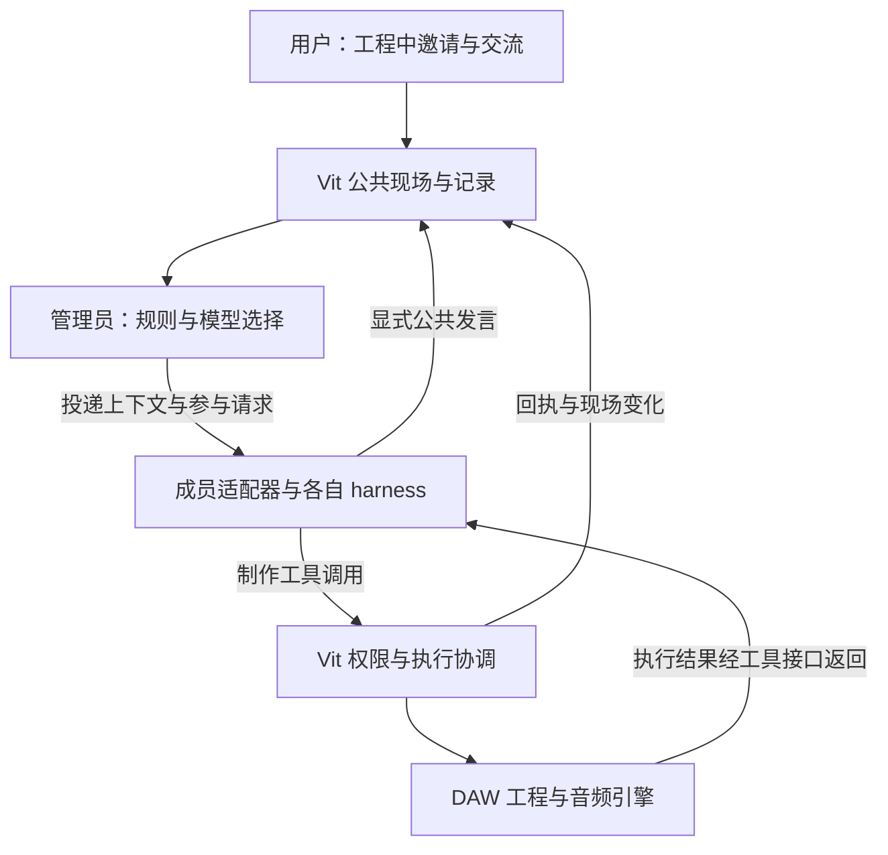

# Vit 开放录音棚协作方案 v1（设计定稿）

- 日期：2026-11-07（Asia/Shanghai）。
- 状态：**用户确认总体方案定调，设计定稿落档；尚未实施、尚未完成外部多 agent 真实栈验证。**
- 确认依据：本次连续讨论在明确“公共发言与制作操作采用结构化接口分流”后，用户指示：“没问题，那这套方案基本定调了！可以准备定稿落档了”。
- 整理：Codex，本次开放录音棚与群聊设计会话；本文记录用户确认的产品方向和架构边界，不代替实现验收。
- 文档关系：本文为本轮后续工作的统一设计入口；[讨论摘要](../reports/2026-11-07-vit-open-studio-agent-group-discussion-summary.md)与[现有机制调研](../reports/2026-11-07-agent-groupchat-existing-mechanisms-research.md)保留推演及证据。早期建议与本文冲突时，以本文为准。
- 授权范围：整理、定稿与登记。本次不发实施卡、不改变主线排序、不运行付费实验、不启动真实栈，也不改变开发卡池的人工作业与验收协议。

## 1. 已确定的设计

1. **Vit 提供录音棚、排练室和公共制作现场。** 用户在 Vit 工程中邀请成员；工程、素材与制作活动先存在，群聊围绕这个现场展开。
2. **成员可以带着自己的 harness 参与。** 外部 agent 保留自己的规划、工具循环和会话管理；相同模型 API 调用不能冒充用户原有 agent 会话。
3. **用户主动邀请一批成员时，触发这些成员各回应一轮。** 以真实初始意见建立讨论状态；这个一次性入场批次与逐消息全员推理分开。
4. **后续公共对话统一由管理员安排投递和回复提醒。** 管理员结合工程现场、已发生的讨论、明确点名和成员状态，选择参与者或等待，不固定轮流。
5. **管理员由 Vit 承载，默认方向是复用 Vit 配置的模型。** 管理职责由程序规则与模型判断共同完成；管理员身份不意味着每次事件都调用模型。
6. **持续阶段只选择性唤醒。** 不采用全员持续思考，也不让全员逐次调用模型判断“是否想接话”。未被启动的成员可以在 Vit 中积累未读记录。
7. **被邀请者按最新公共现场继续思考。** 后续回复应能包含同伴的新发言和相关工程变化，并因此改变观点、行动或放弃发言。
8. **外部成员可以直接操作 Vit。** 其工具请求独立进入 Vit 权限与执行层，结果直接返回原 harness，不经管理员模型重新规划或逐条批准。
9. **公共发言与制作操作按结构化接口分流。** 显式公共发布进入群聊协调，制作工具进入执行层；普通文本不自动变成操作，过程日志不自动变成公共发言。
10. **执行结果回到同一公共现场。** 工程变化与可核查回执成为后续讨论的依据，操作是否成功以实际结果为准。

这些是产品与架构定调。具体协议字段、各端版本、预算数值与 UI 细节见 §13 的待细化项，不据此声称功能已可使用。

## 2. 录音棚的公共上下文

公共上下文既包含音乐工作对象，也包含人类与成员围绕对象留下的交流。它不等于一个持续增长的聊天字符串。

| 内容 | 来源与作用 |
|---|---|
| 工程、轨道、片段、插件、路由、相关时间范围 | Vit 工程状态；明确成员正在讨论和操作什么 |
| 音频、乐谱、歌词、参考资料与试听版本 | 带版本/工件引用的素材；记录实际向成员提供了什么 |
| 当前议题、创作意图、用户偏好、已选决定、未决问题 | 用户输入及可追溯的讨论记录；支持持续制作企划 |
| 观察、实验、执行回执和工程变化 | Vit 相应数据源；用于检查事实与方案后果 |
| 成员原始发言、回复关系、方案来源 | 公共消息记录；保留分歧和观点变化 |

工程状态、用户选择与成员解释分别保留来源。成员说“已完成”不会自动升级为执行事实；多人赞同也不会自动替代用户的创作决定。

成员有权访问现场，不等于已读完或听过全部材料。每次参与应能追溯所依据的消息范围、工程版本与实际披露的材料。共享存储不免除模型读取成本，采用简报、增量和按需展开。

既有观察约束继续适用：DAD 与 DOM/MOM/TIM/TOM/FXM/COM/EPM/RLM 保持 peer 拓扑；CCB 依显式 view 请求做有界披露；优先消费投影的 `LLMContext`，不因群聊展开 raw package，缺失、partial、stale 状态原样保留。群聊适配不能把现有观察层改成另一条自动推断管线。

## 3. 组件职责与架构



| 角色/组件 | 职责 |
|---|---|
| 用户 | 选择参与者、提出制作目标、按现有模式授予操作范围、决定创作取舍和停止 |
| 公共现场与消息存储 | 保存工程引用、原始发言、事件和工件；维护版本、顺序与可追溯关系 |
| 管理员 | 安排公共对话投递、提醒、续聊、等待与停止；结合现场与实际发言选人 |
| 成员适配器 | 连接各家运行时，映射身份、会话、结构化事件、工具请求与执行结果 |
| 成员自身 harness | 保持本人的上下文、规划与工具循环，执行受邀工作并选择何时公开汇报 |
| Vit 权限与执行层 | 检查操作范围、参数和基线，协调共同工程写入，执行并返回回执 |

管理员可以在必要时作为 Vit 参与者发言，但公开建议与内部调度决定应有可区分的身份/事件。管理员不会替其他成员改写立场，也不拥有额外的工程写权限。

“唤醒”指开始模型推理或工具工作轮次；建立连接、保存收件、恢复空会话与启动推理应分别记账。

## 4. 入群与持续讨论流程

### 4.1 工程中邀请成员

用户在工程内选择参与者，Vit 绑定成员与各自运行时会话，并准备当前现场简报：相关工程版本、制作焦点、用户议题、必要材料与允许的工作范围。

同时邀请的成员各作首轮回应，允许并发形成初步意见。公开发言进入共同记录，管理员由此获得真实方案、关注问题与分歧。首轮应回应制作议题，不强制空泛自我介绍。

并发首轮不假定成员已读到彼此输出。后续实际补读并回应才形成相互影响。首轮失败、超时和未就绪状态显式记录，不无限等待全员成功，也不把失败计为已发言。

中途加入只初始化新增成员，以当前现场与已有讨论补齐背景；不因此重新启动全部成员首轮。重新连接也不应重复触发入群回应。

### 4.2 后续发言与提醒

1. 用户消息、成员公共发言或相关现场事件先落入 Vit 记录。
2. 管理员入口检查明确回复关系、点名、忙闲、取消状态、待处理内容与剩余预算。
3. 规则已确定接收者时直接投递；存在多个合理选择且需要语义判断时，再进行受预算约束的模型选择。也允许等待、合并消息或结束本次自动续聊。
4. 被选成员取得相关未读发言及现场更新，继续自己的会话。它可以回应、使用工具、请求材料，也可以确认无新增内容并结束本次工作。
5. 新发言或结果回写公共现场后，再判断下一步；不在开场就排定 A→B→C 全轮顺序。

明确 @ 表达希望哪个成员参与，通过同一管理员入口的程序规则处理；成员之间的点名交接仍受可用性和续聊预算约束，不无限相互唤醒。明确点名不自动授予更多工程操作权限。

管理员选择的是谁值得被邀请处理当前问题，不声称未被启动的成员已经读过消息、想过问题并决定沉默。

### 4.3 连续性与自然感

自然参与以实际接续为目标：记得前述观点，回应具体内容，因证据改变判断，意见已被覆盖时少说，结果回来时跟进未决问题。角色可以随实际工作发展，不按模型厂商固定人格或强制制造分歧。

例如：用户试听 B 版副歌后仍不满意；首轮 A 建议改旋律，B 主张保留旋律、先试留白。管理员可邀请 A 结合用户偏好和 B 的方案调整实验顺序。A 必须收到这些相关记录后再回应，不能提前生成答案并排队展示。

无需每次全员表态或每轮生成“最终答案”；一次有效回应、保留分歧、等待试听都可以是正常结果。

## 5. 上下文收件与并发处理

借鉴 agentschat 的持续公共日志、独立持久会话、增量片段与忙时排队，收件过程本身由普通程序完成。

- 每成员记录有权读取的未读范围；未唤醒成员只积累记录，不自动进行旁听推理。
- 连续输入可以合并成有界片段，避免用户连发几句话就重复启动。
- 已开始处理的片段保留其依据，新消息进入后续片段。根据后端能力在安全边界补充、引导或排队，不默认每来一句就取消重算。
- 回复关联所依据的公共记录位置与工程版本；发布或继续操作前，应处理会改变结论的新约束。对无关更新不强制重算。
- 投递、已确认处理和公开发言分开记录。断线、重试、取消不能通过简单推进一个游标掩盖尚未处理的消息。
- 以稳定事件/投递标识去重，恢复会话时核对已读范围。未知执行状态先核对回执，不通过重发工具请求猜测上次是否成功。

成员在已开始的工作中可按权限查询相关公共历史和现场材料；查询不绕过其他成员的参与调度，也不触发全群。摘要保留原文引用、少数意见与未决问题，不覆盖原记录。

## 6. 对话与操作采用结构化分流

系统识别协议事件、工具名称与参数，避免从自然语言猜测“这句话是否在执行操作”。两条路径可以在同一成员的一次工作中交替使用。

下表名称用于说明语义，**不是现有或已冻结的接口名称**；正式 schema、命名空间和各 harness 映射在实施前细化。

| 结构化入口/事件 | 路由与结果 |
|---|---|
| `room.send({text, reply_to, artifact_refs})` | 验证发送者并保存公共原文；管理员安排向哪些成员投递、是否提醒回应；发布确认直接返回调用者 |
| `vit.*` 制作工具调用 | 进入 Vit 权限与执行层；结果按调用 ID 直接回到原 harness |
| 工具完成、失败与工程变化 | 形成可核查回执/现场事件，关键内容供后续讨论使用 |
| 普通 assistant 文本、进度与日志 | 作为成员工作详情或结束状态；不自动广播，不触发工程修改 |

`room.send` 也可以由工具协议承载；分叉依据是公共通信接口与制作接口的结构化身份。若某端通过其他原生结构化事件表达公共发布，其适配必须明确约定，不以文本关键词临时猜测。

只说“我已调低音量”不会改变工程；只有实际制作调用及回执证明操作。所有工具和公共发言的发送者由已绑定会话确定，不能由模型自行填写一个身份字段就取得其他成员身份。

不把思考轨迹、完整工具日志或其他会话内容自动抄入公共群；仅使用后端实际提供且适合披露的事件。

## 7. 外部 agent 直接操作 Vit

外部 agent 在用户授予的范围内，直接调用 Vit 工具来读取、编辑、生成、渲染和检查结果。其自身 harness 继续决定工具顺序和后续行动。具体可用能力以 Vit 当前实现和对外披露为准，入群不代表所有能力均已开放。

操作流程为：

```text
成员 harness → Vit 工具入口 → 权限/参数/执行基线检查
             → 统一执行协调 → DAW → 结果返回同一工具调用
                                    ↘ 回执与工程变化进入公共现场
```

管理员不插入每次工具调用的额外模型推理。调用者无需等管理员转述结果，便可在自己的工作循环中继续检查与操作。关键变化作为公共现场更新保留，也不需要管理员先阅读才能生效。

### 7.1 权限与共同工程

操作权限依据用户的工程授权和既有准入机制；获得发言机会不等于获得修改许可。外部调用须绑定成员、工程和授权范围，不能将客户端自报的“已确认”等字段直接当成授权证据。

共享同一工程的修改进入共同执行协调范围。v1 以可并发读取、工程级协调写入为基础，写入前核对当前基线，结果可追溯；依赖特定版本的读取/渲染也要绑定相应现场版本。排队解决同时写入，版本核对处理等待期间现场已变的情况。

不能让每个外部进程各持一把私有锁后，就声称工程全局互斥。直接绕过共同入口连接内核写入，不属于本方案的外部 agent 操作路径。撤回或恢复还需核对后续他人改动，不能直接全局回滚覆盖其他成员的工作。

并行实验不同制作方案可后续研究独立工程副本/分支，不作为 v1 已具备能力。

### 7.2 结果与讨论回流

例如 A 接到副歌实验后，可连续读取轨道、修改参数、生成试听和检查结果，最后公开汇报 B 版。其他成员下次参与时补读相关变化与试听引用；每个内部工具步骤都不必变成一次群聊提醒。

工具调用完成、候选被接受、方案被公开讨论与用户最终选定，保留不同状态；不能相互替代。

## 8. token 与延迟约束

成本控制发生在启动模型之前，不能只通过隐藏回复控制表面话量。

- 一次主动邀请可承担该批 N 位成员的首轮运行；普通后续消息不默认产生 N 次成员调用。
- 明确 @、单一候选、空收件、忙时排队、事件合并等优先由程序处理。
- 模糊情况下为管理员选择设置独立输入、输出、重试和续聊预算。成员执行与工具循环另记成本，不把完整工程和全群私有会话塞给选人模型。
- 不采用逐消息全员意愿判断、定时全员旁听推理或全员持续生成想法作为默认路径。
- 成员读取历史仍可能计费；增量传输不保证历史免费计算，跨厂商也不共享推理缓存。
- 缓存可作优化，不能作为成本承诺。管理员、成员、总结、工具续跑与失败重试分别记账；供应商不提供完整 usage 时显式记录未知，不伪造精确费用。
- 用户自带运行时的账号、额度与 API 计费按各端实际支持核对，不能承诺接入后沿用任意已有订阅。

可以将普通续聊设计为“规则已确定人选时 0 次选人模型调用；模糊情形在限定预算内选择，再运行被选成员”。这是目标调用结构，实际 token 与选择质量尚待测量。

## 9. 运行状态与失败处理原则

公共日志与执行回执持久保存，调度失败不能吞掉原始输入；暂停讨论也不删除未读记录。

成员离线、忙碌、调用失败、无补充与操作失败分别呈现。失败不静默改用其他模型，不自动回退成全员广播，也不无限重试。

管理员不可用时保留记录与状态；已有程序规则能处理的明确路由按同一权限继续处理，模糊自动续聊等待恢复或用户明确选择。具体恢复与去重协议实施前确定。

用户停止、工程切换或新约束需要传递到相关运行。停止继续邀请和取消已经开始的工具工作分开记录；取消后工程是否已变化，以执行回执及状态核对为准。

操作过程中产生的大量低层事件可积累和归并，不因每次测量或参数回读都启动管理员模型。关键结果、用户输入与明确交接形成后续协调依据。

## 10. 三个项目的经验如何使用

| 参考 | 借鉴到 Vit 的部分 | 不直接沿用的部分 |
|---|---|---|
| [Microsoft Agent Framework Group Chat](https://learn.microsoft.com/en-us/agent-framework/workflows/orchestrations/group-chat)；[AutoGen SelectorGroupChat](https://microsoft.github.io/autogen/stable/user-guide/agentchat-user-guide/selector-group-chat.html) | 公共历史与独立会话同步；程序选择/模型选择分开；确定人选时跳过选人调用 | 不假定完整 orchestrator 天然便宜，不采用无限历史和无上限重试；AutoGen 只作机制参考，官方推荐后继框架 |
| [agentschat](https://github.com/mocias/agentschat) | 跨 harness 会话适配、公共日志、成员游标、分段收件、忙时排队与恢复 | 不用定时全员投递触发全员推理，不将不受支持的原生桌面配置改写当成接入前提 |
| [DSH Agent Arena](https://github.com/Tikzen/dsh-agent-arena) | 入场首轮；管理员安排续聊；跳过成员独立判断、直接由管理员选择的分支；停止与运行统计 | 不采用全员逐次判断意愿，不据其指定 DSH 版本的能力推导任意外部 harness 已可接入 |

[Inner Thoughts](https://arxiv.org/html/2501.00383v2)仅保留表达动机和自然参与的研究启发，其全员持续思考执行结构不进入默认方案。其他广播或竞技场方案不能因使用“群聊”名称就视为满足本设计。

本方案使用上述机制经验，不决定把任一完整框架引入 Vit；依赖选型需另行评估。

## 11. 仓库现有复用基础与缺口

本节基于本会话只读核对，不代表外部协作已实测。

| 入口/组件 | 已核对基础 | 仍需验证或实现 |
|---|---|---|
| [chat/server.go](../../agent/internal/chat/server.go) | 存在 `/agent/tools`、`/agent/actions`、`/agent/invoke` 等路由；结构化 invoke 不要求先走群聊选择 | 外部成员身份与项目授权、公共发布及投递接口、各路径一致性 |
| [tools/catalog.go](../../agent/internal/tools/catalog.go) | 有输入 schema、修改工程标记、确认与撤销等元数据 | 对外工具能力映射与真实可执行范围 |
| [executor.go](../../agent/internal/executor/executor.go) | 工具调用、调用 ID 与结果返回的现成执行路径 | 接入外部 harness 后的事件关联与回执归属 |
| [executionruntime/coordinator.go](../../agent/internal/executionruntime/coordinator.go)、[writelease.go](../../agent/internal/executionruntime/writelease.go) | 执行基线、持久化及工程级写租约等基础 | 全部外部写入口是否汇入共同协调；当前租约为进程内范围 |
| [VSP Hub Extension API](../../docs/vsp/VSP_HUB_EXTENSION_API.md) | 第三方身份、状态与事件接入；默认拒绝扩展写命令 | 完整外部操作授权与执行接线；不能把只读探针当成完整写入能力 |
| [观察拓扑清单](../../docs/OBSERVATION_PROJECTION_MANIFEST.md) | 公共观察来源及披露约束 | 对外成员可获取的具体视图、范围与版本绑定 |

已有部件不等于产品闭环。后续必须核查实际路径，不通过直接暴露内核端口或替外部成员伪装 VitAgent 身份来补齐缺口。

## 12. 后续验证应回答的问题

以下为未来实现的验收方向，不是本次已经执行的测试，也不预设实验预算或成功比例。

1. 同时邀请 N 位成员只产生一次入场批次；重连、普通输入和新增单个成员不重复启动全群。
2. B 后续实际收到 A 的新发言与相关工程更新，回执可追溯；测试包含 B 因此修改建议或放弃重复内容的场景。
3. 未被选择成员的收件和空闲等待不调用其模型；程序明确路由能跳过选人模型。
4. 新消息、忙时队列、超时与重启不会静默漏投、重复发布，或不明状态下重复执行工程操作。
5. 公共发言、制作调用和过程日志按结构化事件确定分流；未调用工具的自然语言不产生工程修改。
6. 外部成员的有效工具请求能在自身 harness 内完成读取、修改与结果核对，过程中不要求管理员模型逐条参与；未获授权或基线不匹配时得到明确结果。
7. 两个成员操作同一工程时，验证共同写入协调、版本变化与回执归属，不能只验证各自私有锁。
8. 管理员、成员推理、工具续跑和失败重试分别记录调用量、usage 与延迟，评估在明确预算下能否推进实际制作讨论；不凭调用次数直接宣称费用比例。

实现验收继续遵守仓库要求：真实 VitApp、Godot 与 Go agent 栈，复用 ps1 烟测体系并以 exit 0 为门槛；涉及渲染/旅程须验证相应覆盖。用户人工体验从 Godot 启动链进入工程，不作为第一道功能验证。当前文档落档不占用真实栈。

## 13. 实施前待细化项

| 项目 | 已定调的边界 | 待细化内容 |
|---|---|---|
| 管理员 | Vit 承载，程序规则与配置模型共同协调 | 是否独立管理会话、上下文构造、候选选择和停止策略 |
| 预算 | 无全员持续推理，调度与成员执行分开记账 | 输入/输出上限、自动续聊数、重试/超时、费用呈现 |
| 成员接入 | 各自 harness 与结构化事件适配 | 各家实际支持版本、身份绑定、已有会话恢复、取消/引导能力 |
| 入场 | 用户邀请批次各首轮回应，后续选择性参与 | 简报字段、首轮收集时机、失败/迟到与用户插话处理 |
| 上下文 | Vit 公共现场、原文与引用、成员增量收件 | 事件/投递 schema、游标确认、摘要策略、恢复去重 |
| 公共发布与操作 | 两条结构化入口，操作不经管理员模型 | 正式命名、schema、原生事件映射、能力发现 |
| 工程执行 | 用户授权、统一协调、实际回执 | 所有工具接线覆盖、锁/版本粒度、撤回及并行实验条件 |
| 界面与体验 | 工程中邀请、可见成员与制作进展 | 控件布局、状态呈现、方案/试听工件与消息的交互细节 |

细化工作不能悄悄恢复全员旁听推理、逐工具管理员审批或自然语言猜测分流。若证据要求修改本节以上的已定调边界，应记录新的设计修订及依据。

## 14. 落档与后续入口

本文完成本轮设计收口，讨论摘要与调研保留来源并指向本文。未来用户触发实施时，由相应决策流依据本方案完成接口细化、拆卡与排序，按既有卡池流程执行和独立验收。

当前没有新实施卡、付费模型实验或外部 agent 写入运行结果；设计定稿、实现完成、真实栈验收通过和代码提交为不同状态。
