# 第二单元定向文本提取（源材料）

仅 PDF 第2页目录及第20-35页；保留提取顺序，删除页脚乱码行。
谱例音符和部分乐理符号不在文本层，须查看同页 PNG；本文件不是校订乐谱。

## PDF 第 2 页

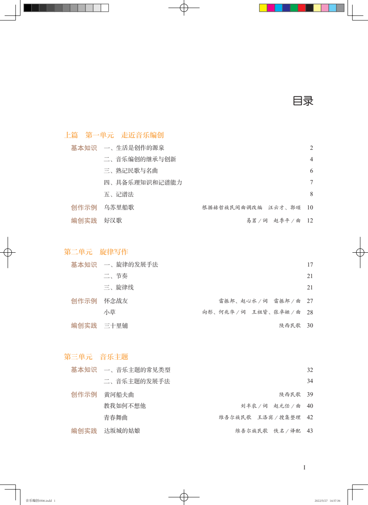

I
目录
上篇  第一单元  走近音乐编创
基本知识　一、生活是创作的源泉	 	 2
二、音乐编创的继承与创新	 	 4
三、熟记民歌与名曲	 	 6
四、具备乐理知识和记谱能力	 	 7
五、记谱法		 8
创作示例　乌苏里船歌	 根据赫哲族民间曲调改编  汪云才、郭颂  10
编创实践　好汉歌	 易茗／词　赵季平／曲  12
第二单元  旋律写作
基本知识　一、旋律的发展手法	 	 17
二、节奏	 	 21
三、旋律线	 	 21
创作示例　怀念战友	 雷振邦、赵心水／词  雷振邦／曲  27
小草	 向彤、何兆华／词  王祖皆、张卓娅／曲  28
编创实践　三十里铺	 陕西民歌  30
第三单元  音乐主题
基本知识　一、音乐主题的常见类型	 	 32
二、音乐主题的发展手法	 	 34
创作示例　黄河船夫曲	 陕西民歌  39
教我如何不想他	 刘半农／词  赵元任／曲  40
青春舞曲	 维吾尔族民歌  王洛宾／搜集整理  42
编创实践　达坂城的姑娘	 维吾尔族民歌　佚名／译配	 43

## PDF 第 20 页

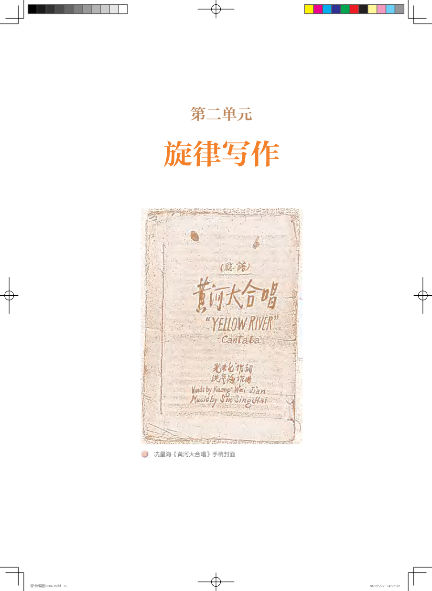

旋律写作
第二单元
  冼星海《黄河大合唱》手稿封面

## PDF 第 21 页 / 书内第 16 页

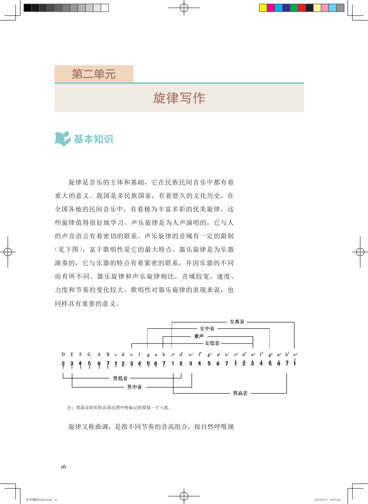

16
旋律是音乐的主体和基础，它在民族民间音乐中都有着
重大的意义。我国是多民族国家，有着悠久的文化历史，在
全国各地的民间音乐中，有着极为丰富多彩的优美旋律，这
些旋律值得很好地学习。声乐旋律是为人声演唱的，它与人
的声音语言有着密切的联系。声乐旋律的音域有一定的限制
（见下图） ，富于歌唱性是它的最大特点。器乐旋律是为乐器
演奏的，它与乐器的特点有着紧密的联系，并因乐器的不同
而有所不同。器乐旋律和声乐旋律相比，音域较宽，速度、
力度和节奏的变化较大。歌唱性对器乐旋律的表现来说，也
同样具有重要的意义。
注：男高音的实际音高比图中所标记的要低一个八度。
旋律又称曲调，是指不同节奏的音高组合，按自然呼吸规
旋律写作
第二单元

## PDF 第 22 页 / 书内第 17 页

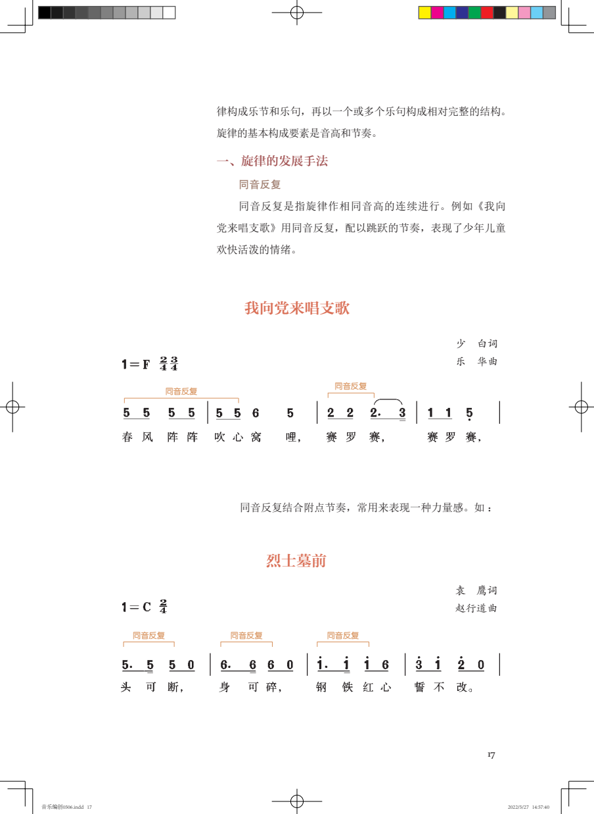

17
同音反复结合附点节奏，常用来表现一种力量感。如 ：
我向党来唱支歌
少　白词   
乐　华曲
同音反复 同音反复
同音反复 同音反复 同音反复
律构成乐节和乐句，再以一个或多个乐句构成相对完整的结构。
旋律的基本构成要素是音高和节奏。
一、旋律的发展手法
同音反复
同音反复是指旋律作相同音高的连续进行。例如《我向
党来唱支歌》用同音反复，配以跳跃的节奏，表现了少年儿童
欢快活泼的情绪。
烈士墓前
袁　鹰词
赵行道曲

## PDF 第 23 页 / 书内第 18 页

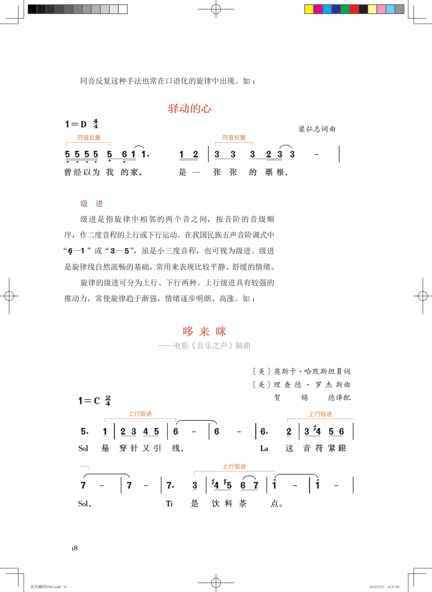

18
级　进
级进是指旋律中相邻的两个音之间，按音阶的音级顺
序，作二度音程的上行或下行运动。在我国民族五声音阶调式中 
“
 —
 ”或“
 —
 ” ，虽是小三度音程，也可视为级进。级进
是旋律线自然流畅的基础，常用来表现比较平静、舒缓的情绪。
旋律的级进可分为上行、下行两种。上行级进具有较强的
推动力，常使旋律趋于渐强，情绪逐步明朗、高涨。如 ：
哆来咪
—电影《音乐之声》插曲
〔美〕奥斯卡·哈默斯坦Ⅱ词
〔 美 〕 理查德·罗杰斯 曲
贺　　  锡  　　德译配
上行级进 上行级进
上行级进
驿动的心
梁弘志词曲
同音反复 同音反复
同音反复这种手法也常在口语化的旋律中出现。如 ：

## PDF 第 24 页 / 书内第 19 页

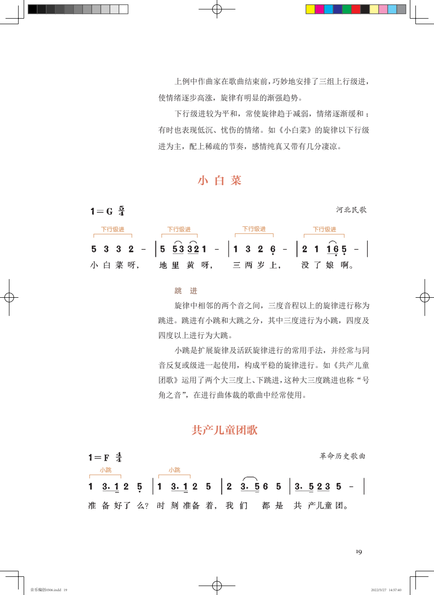

19
小白菜
河北民歌
下行级进 下行级进 下行级进 下行级进
跳　进
旋律中相邻的两个音之间，三度音程以上的旋律进行称为
跳进。跳进有小跳和大跳之分，其中三度进行为小跳，四度及
四度以上进行为大跳。
小跳是扩展旋律及活跃旋律进行的常用手法，并经常与同
音反复或级进一起使用，构成平稳的旋律进行。如《共产儿童
团歌》运用了两个大三度上、 下跳进， 这种大三度跳进也称“号
角之音” ，在进行曲体裁的歌曲中经常使用。
上例中作曲家在歌曲结束前， 巧妙地安排了三组上行级进，
使情绪逐步高涨，旋律有明显的渐强趋势。
下行级进较为平和，常使旋律趋于减弱，情绪逐渐缓和；
有时也表现低沉、忧伤的情绪。如《小白菜》的旋律以下行级
进为主，配上稀疏的节奏，感情纯真又带有几分凄凉。
共产儿童团歌
小跳 小跳
革命历史歌曲

## PDF 第 25 页 / 书内第 20 页

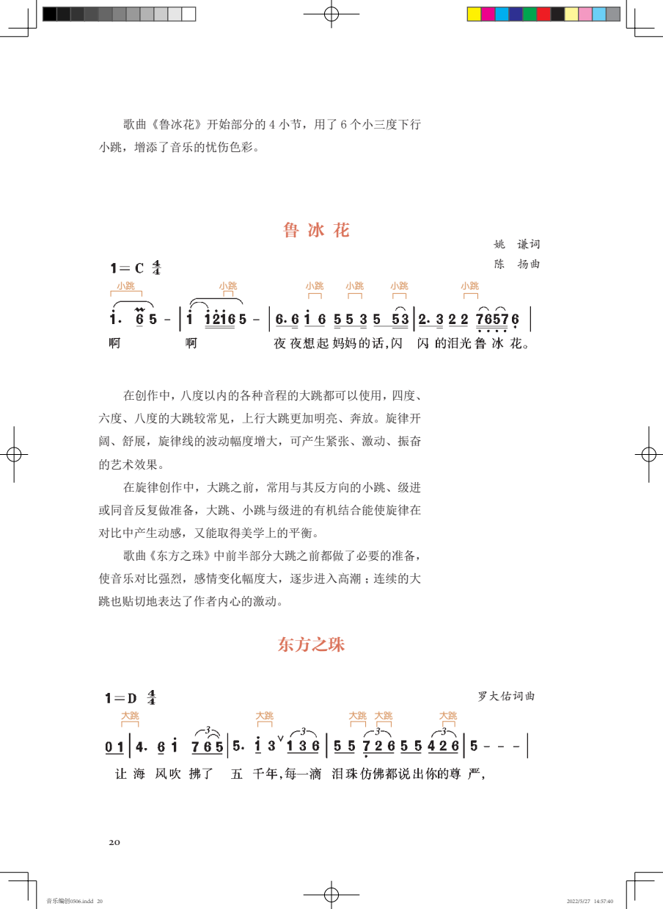

20
在创作中，八度以内的各种音程的大跳都可以使用，四度、
六度、八度的大跳较常见，上行大跳更加明亮、奔放。旋律开
阔、舒展，旋律线的波动幅度增大，可产生紧张、激动、振奋
的艺术效果。
在旋律创作中，大跳之前，常用与其反方向的小跳、级进
或同音反复做准备，大跳、小跳与级进的有机结合能使旋律在
对比中产生动感，又能取得美学上的平衡。
歌曲《东方之珠》中前半部分大跳之前都做了必要的准备，
使音乐对比强烈，感情变化幅度大，逐步进入高潮 ； 连续的大
跳也贴切地表达了作者内心的激动。
鲁冰花
姚　谦词
陈　扬曲
小跳 小跳 小跳 小跳 小跳 小跳
歌曲《鲁冰花》开始部分的 4 小节，用了 6 个小三度下行
小跳，增添了音乐的忧伤色彩。
东方之珠
罗大佑词曲
大跳 大跳 大跳大跳大跳

## PDF 第 26 页 / 书内第 21 页

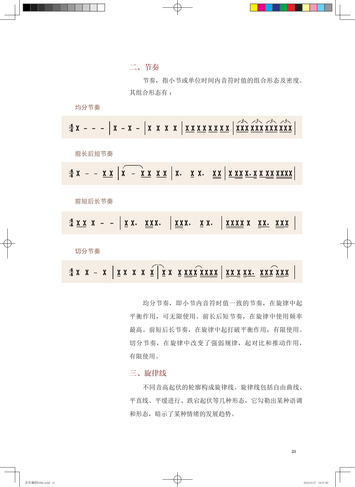

21
前长后短节奏
前短后长节奏
均分节奏，即小节内音符时值一致的节奏，在旋律中起
平衡作用，可无限使用。前长后短节奏，在旋律中使用频率
最高。前短后长节奏，在旋律中起打破平衡作用，有限使用。
切分节奏，在旋律中改变了强弱规律，起对比和推动作用，
有限使用。
三、旋律线
不同音高起伏的轮廓构成旋律线。旋律线包括自由曲线、
平直线、平缓进行、跌宕起伏等几种形态，它勾勒出某种语调
和形态，暗示了某种情绪的发展趋势。
二、节奏
节奏，指小节或单位时间内音符时值的组合形态及密度。
其组合形态有 ：
切分节奏
均分节奏

## PDF 第 27 页 / 书内第 22 页

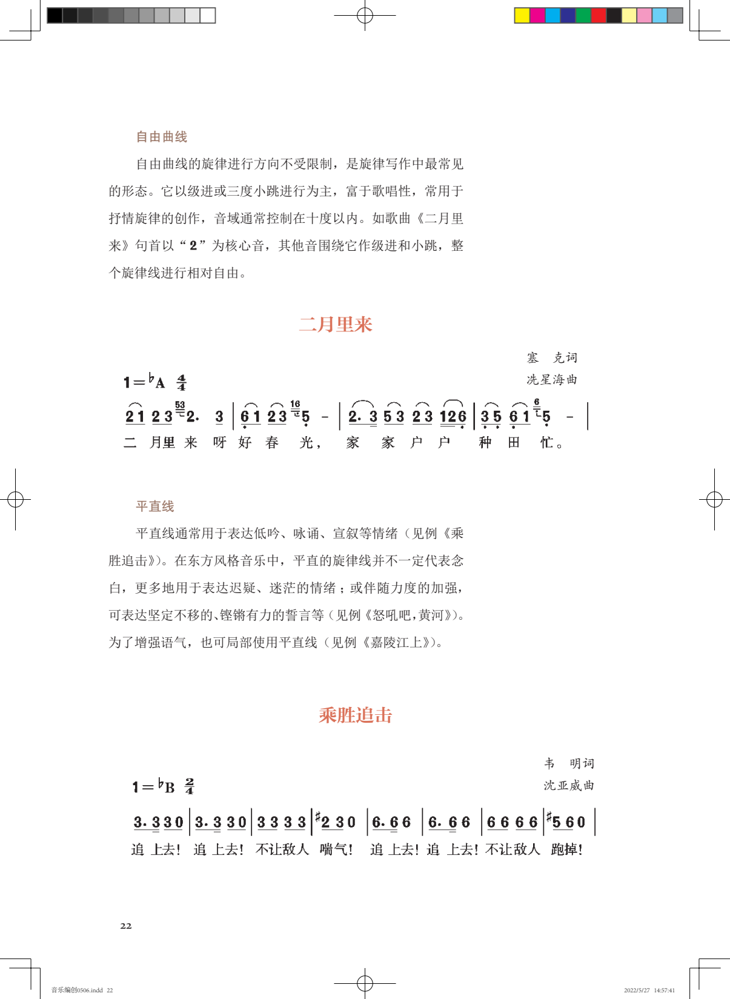

22
自由曲线
自由曲线的旋律进行方向不受限制，是旋律写作中最常见
的形态。它以级进或三度小跳进行为主，富于歌唱性，常用于
抒情旋律的创作，音域通常控制在十度以内。如歌曲《二月里
来》句首以“
 ”为核心音，其他音围绕它作级进和小跳，整
个旋律线进行相对自由。
平直线
平直线通常用于表达低吟、咏诵、宣叙等情绪（见例《乘
胜追击》 ） 。在东方风格音乐中，平直的旋律线并不一定代表念
白，更多地用于表达迟疑、迷茫的情绪； 或伴随力度的加强，
可表达坚定不移的、 铿锵有力的誓言等（见例《怒吼吧， 黄河》 ） 。
为了增强语气，也可局部使用平直线（见例《嘉陵江上》 ） 。
塞　克词
冼星海曲
二月里来
韦　明词
沈亚威曲
乘胜追击

## PDF 第 28 页 / 书内第 23 页

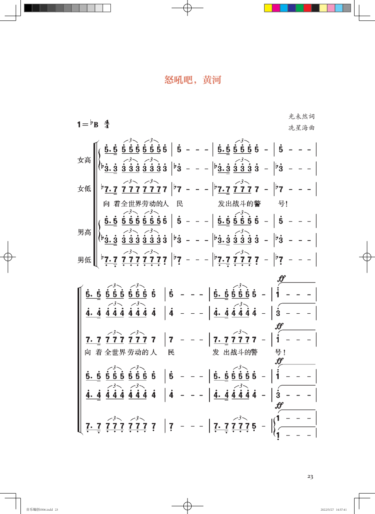

23
怒吼吧，黄河
光未然词
冼星海曲

## PDF 第 29 页 / 书内第 24 页

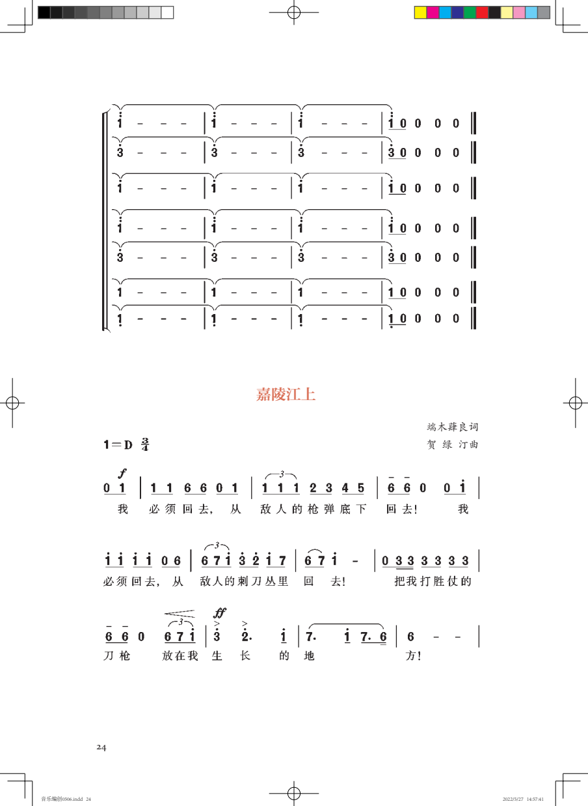

24
嘉陵江上
端木蕼良词
贺  绿  汀曲

## PDF 第 30 页 / 书内第 25 页

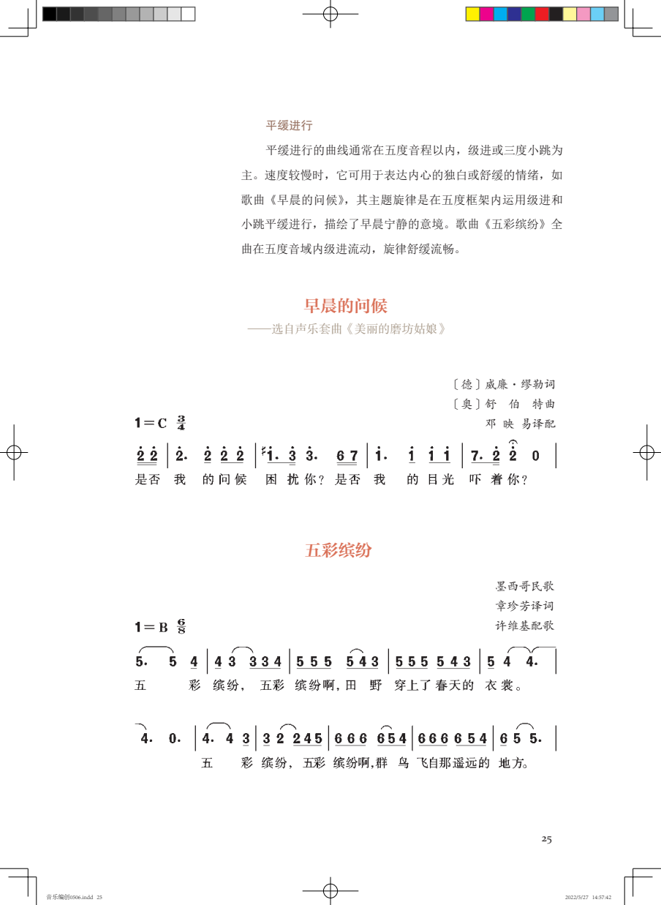

25
平缓进行
平缓进行的曲线通常在五度音程以内，级进或三度小跳为
主。速度较慢时，它可用于表达内心的独白或舒缓的情绪，如
歌曲《早晨的问候》 ，其主题旋律是在五度框架内运用级进和
小跳平缓进行，描绘了早晨宁静的意境。歌曲《五彩缤纷》全
曲在五度音域内级进流动，旋律舒缓流畅。
早晨的问候
—选自声乐套曲《美丽的磨坊姑娘》
〔德〕威廉·缪勒词
〔奥〕舒 伯 特曲
邓 映 易译配
五彩缤纷
墨西哥民歌
章珍芳译词
许维基配歌

## PDF 第 31 页 / 书内第 26 页

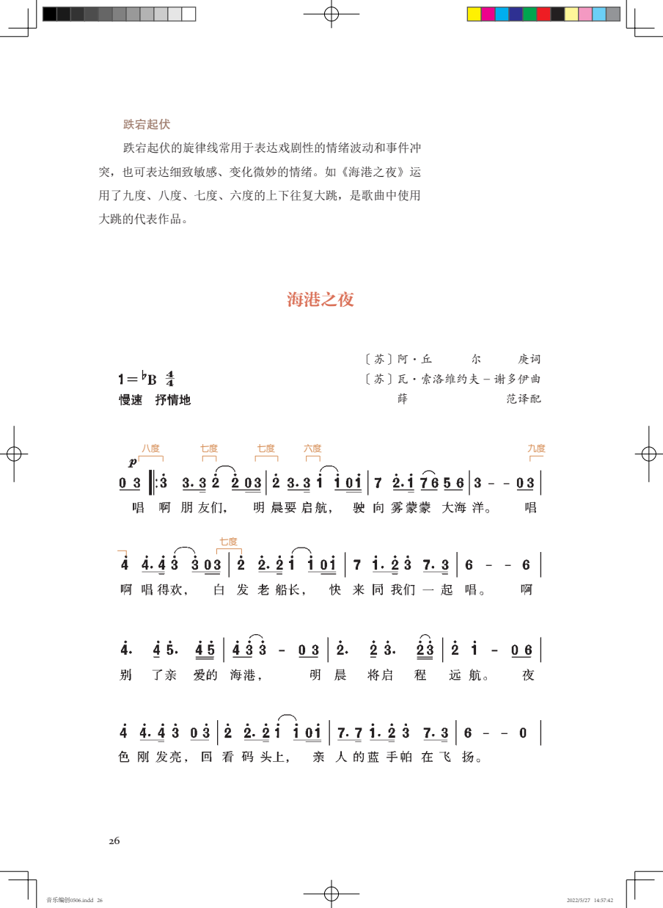

26
跌宕起伏
跌宕起伏的旋律线常用于表达戏剧性的情绪波动和事件冲
突，也可表达细致敏感、变化微妙的情绪。如《海港之夜》运
用了九度、八度、七度、六度的上下往复大跳，是歌曲中使用
大跳的代表作品。
海港之夜
〔苏〕阿·丘　　　 尔　　　庚词
〔苏〕瓦·索洛维约夫 - 谢多伊曲
薛　　　　　　　　 范译配
七度
八度 七度 六度 九度七度

## PDF 第 32 页 / 书内第 27 页

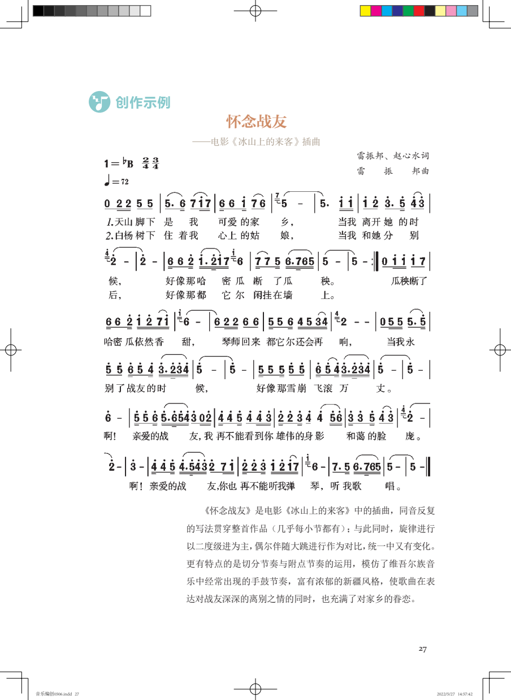

27
怀念战友
—电影《冰山上的来客》插曲
雷振邦、赵心水词
雷　　振　　邦曲
《怀念战友》是电影《冰山上的来客》中的插曲，同音反复
的写法贯穿整首作品（几乎每小节都有） ； 与此同时，旋律进行
以二度级进为主， 偶尔伴随大跳进行作为对比， 统一中又有变化。
更有特点的是切分节奏与附点节奏的运用，模仿了维吾尔族音
乐中经常出现的手鼓节奏，富有浓郁的新疆风格，使歌曲在表
达对战友深深的离别之情的同时，也充满了对家乡的眷恋。

## PDF 第 33 页 / 书内第 28 页

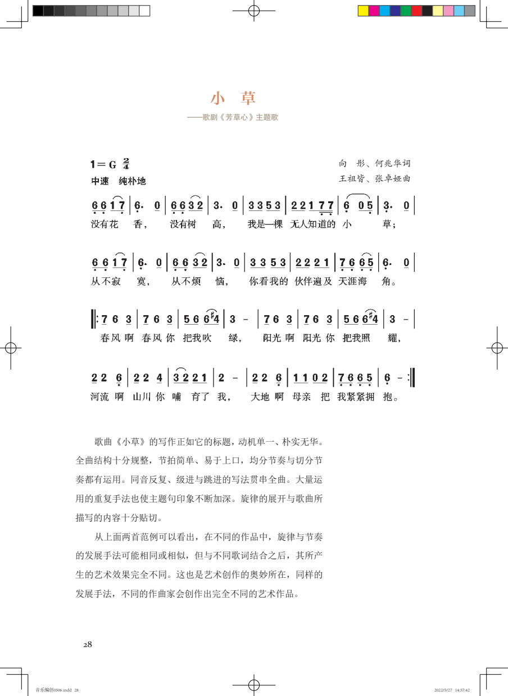

28
小　草
—歌剧《芳草心》主题歌
向　彤、何兆华词
王祖皆、张卓娅曲
歌曲《小草》的写作正如它的标题，动机单一、朴实无华。
全曲结构十分规整，节拍简单、易于上口，均分节奏与切分节
奏都有运用。同音反复、级进与跳进的写法贯串全曲。大量运
用的重复手法也使主题句印象不断加深。旋律的展开与歌曲所
描写的内容十分贴切。
从上面两首范例可以看出，在不同的作品中，旋律与节奏
的发展手法可能相同或相似，但与不同歌词结合之后，其所产
生的艺术效果完全不同。这也是艺术创作的奥妙所在，同样的
发展手法，不同的作曲家会创作出完全不同的艺术作品。

## PDF 第 34 页 / 书内第 29 页

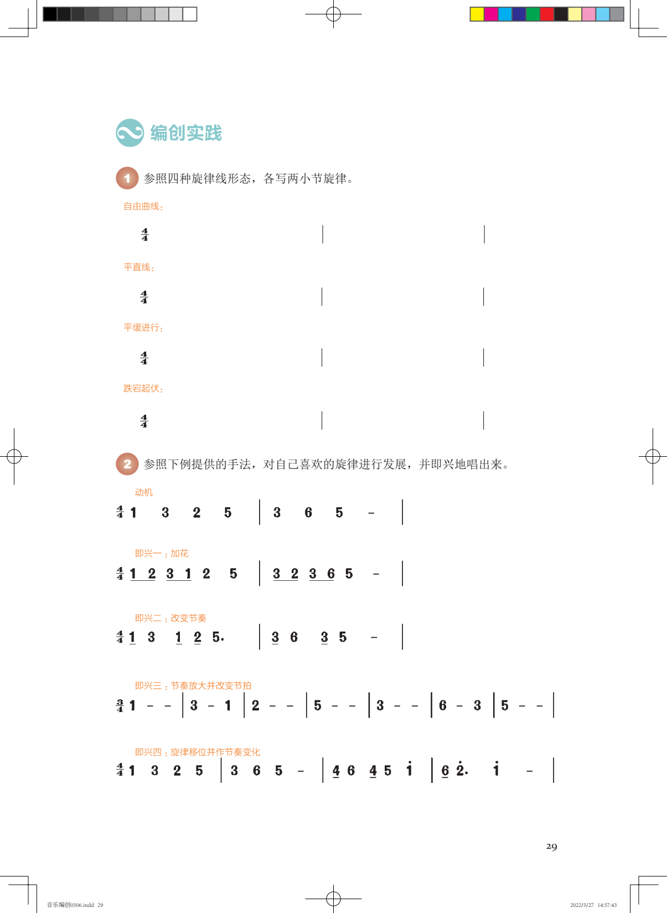

29
1 参照四种旋律线形态，各写两小节旋律。
自由曲线：
平直线：
平缓进行：
跌宕起伏：
2 参照下例提供的手法，对自己喜欢的旋律进行发展，并即兴地唱出来。
动机
即兴一 ： 加花
即兴二 ： 改变节奏
即兴三 ： 节奏放大并改变节拍
即兴四 ： 旋律移位并作节奏变化

## PDF 第 35 页 / 书内第 30 页

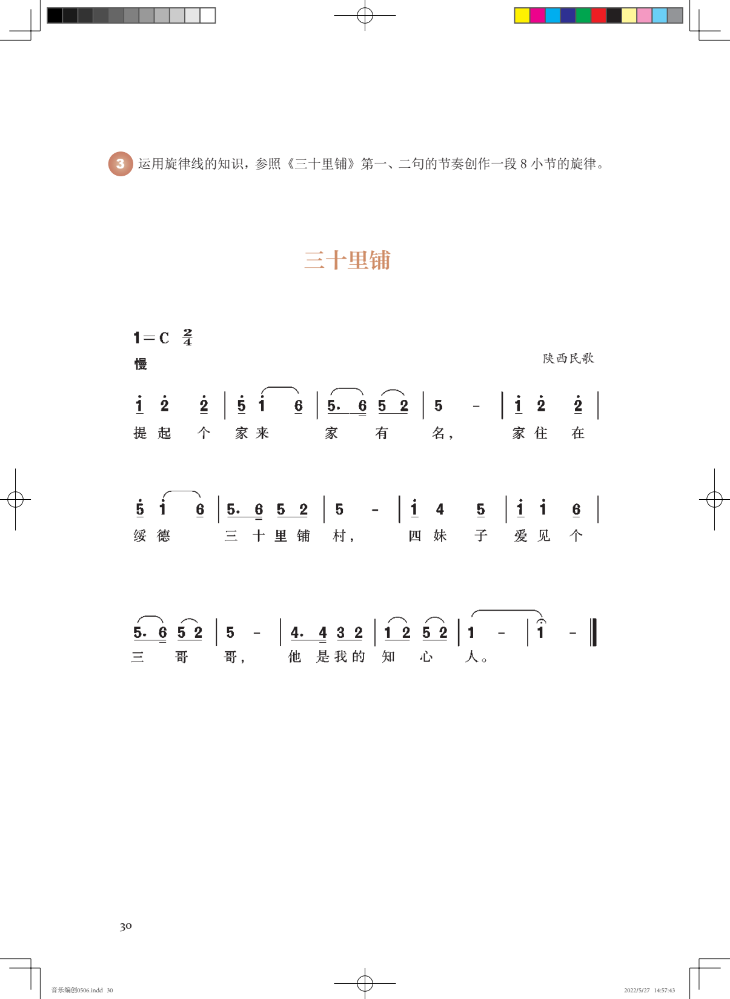

30
三十里铺
陕西民歌
3 运用旋律线的知识，参照《三十里铺》第一、二句的节奏创作一段 8 小节的旋律。
